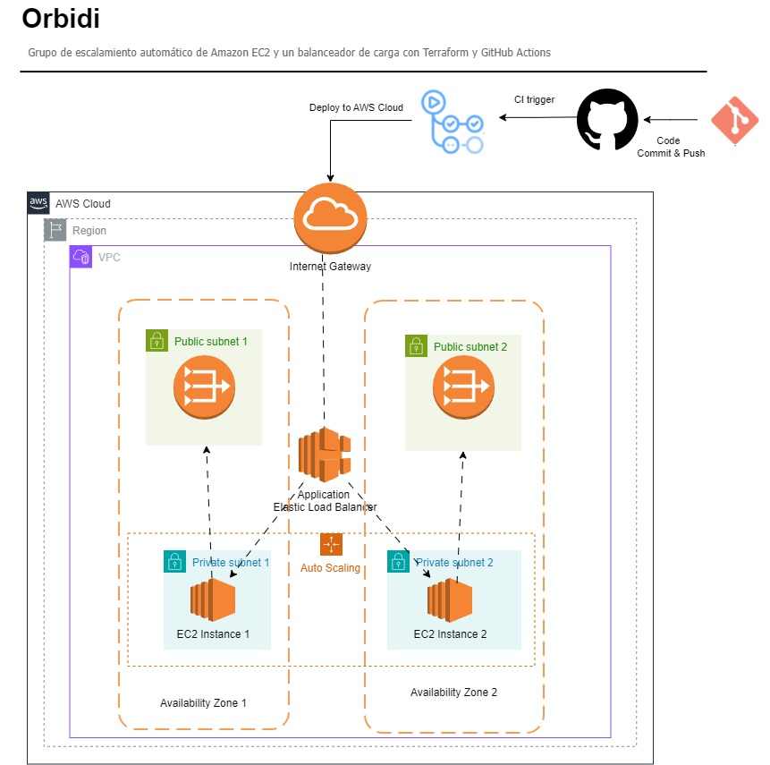
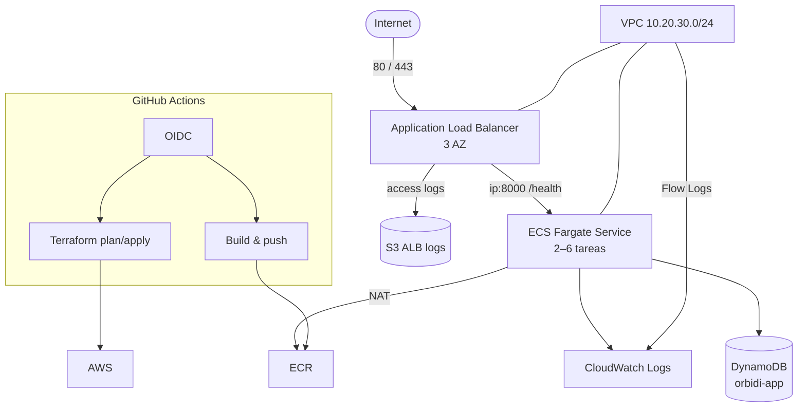

# Orbidi — Infraestructura AWS con Terraform y ECS Fargate

[](https://github.com/oliverhernandezmoreno/Orbidi/actions/workflows/terraform.yml)
[](https://github.com/oliverhernandezmoreno/Orbidi/actions/workflows/code-scan.yml)

Infraestructura como código para una API FastAPI desplegada en **ECS Fargate** detrás de un **Application Load Balancer**, en una VPC multi-AZ, con estado remoto en S3 + DynamoDB y CI/CD con OIDC (sin access keys).



## Arquitectura



| Capa | Recursos |
|---|---|
| Red | VPC `10.20.30.0/24`, 3 subredes públicas, 3 privadas, IGW, 3 NAT Gateway, Flow Logs |
| Balanceo | ALB público, target group `ip:8000`, listener 80 (redirect a 443 si hay certificado) |
| Cómputo | ECS Fargate, 2–6 tareas, CPU target tracking al 70%, circuit breaker |
| Aplicación | FastAPI (`/`, `/health`), imagen en ECR con tags inmutables |
| Datos | DynamoDB `orbidi-app` con PITR, SSE y deletion protection opcional |
| Observabilidad | Log groups, dashboard, 6 alarmas y SNS |
| Seguridad | OIDC GitHub→AWS, IAM mínimo, security groups, HTTPS opcional, VPC Flow Logs |
| Estado | S3 versionado y cifrado + DynamoDB lock table |

## Estructura del repositorio

```
.
├── app/                      # FastAPI + Dockerfile
├── bootstrap/                # Backend remoto, ECR y rol OIDC (estado local)
├── terraform/                # Infraestructura principal (estado remoto)
├── .github/workflows/        # CI: validación, plan/apply, Checkov
├── PLAN.md                   # Diagnóstico, fases y roadmap
├── RUNBOOK.md                # Operación, alarmas y rollback
├── design.md                 # Decisiones de arquitectura (ADR)
├── .checkov.yaml             # Baseline justificado de Checkov
└── .tflint.hcl               # Configuración de TFLint
```

> `apps/simple-app1` y `apps/simple-app2` son submódulos legacy vacíos. La aplicación vigente está en `app/`.

## Requisitos

- Terraform **>= 1.7** (probado con 1.16.6)
- AWS CLI v2 autenticada con permisos para crear la infraestructura
- Docker (para construir la imagen)
- Cuenta de AWS con permisos para crear roles IAM y el provider OIDC

## Quickstart

### 1. Bootstrap (una sola vez)

Crea el bucket de estado, la tabla de locks, el repositorio ECR y el rol OIDC de GitHub. Usa estado local a propósito.

```bash
cd bootstrap
cp terraform.tfvars.example terraform.tfvars
terraform init
terraform apply
```

Guarda los outputs:

```bash
terraform output -raw state_bucket_name
terraform output -raw github_actions_role_arn
terraform output -raw ecr_repository_url
```

### 2. Backend remoto

```bash
cd ../terraform
cp backend.hcl.example backend.hcl
# editar bucket: orbidi-tfstate-<ACCOUNT_ID>
terraform init -backend-config=backend.hcl
```

### 3. Imagen

ECR usa tags inmutables: cada push debe usar un tag nuevo.

```bash
ACCOUNT_ID=$(aws sts get-caller-identity --query Account --output text)
REGION=us-east-1
IMAGE="${ACCOUNT_ID}.dkr.ecr.${REGION}.amazonaws.com/orbidi/api:$(git rev-parse --short HEAD)"

aws ecr get-login-password --region "$REGION" \
  | docker login --username AWS --password-stdin "${ACCOUNT_ID}.dkr.ecr.${REGION}.amazonaws.com"

docker build -t "$IMAGE" ../app
docker push "$IMAGE"
```

### 4. Despliegue

```bash
cp terraform.tfvars.example terraform.tfvars
terraform plan -var="image_tag=$(git rev-parse --short HEAD)" -out=tfplan.binary
terraform apply tfplan.binary
```

### 5. Verificación

```bash
terraform output -raw alb_dns_name
curl -i "http://$(terraform output -raw alb_dns_name)/health"
# HTTP/1.1 200 OK  {"status":"ok"}
```

## CI/CD

Dos workflows:

| Workflow | Cuándo | Qué hace |
|---|---|---|
| `terraform.yml` → `validate` | PR y push a `main` | `fmt`, `init -backend=false`, `validate` y `terraform test` con `mock_provider` (sin credenciales) |
| `terraform.yml` → `lint` | PR y push a `main` | TFLint + Trivy bloqueantes |
| `terraform.yml` → `deploy` | Gateado por `AWS_DEPLOY_ENABLED=true` | Build/push a ECR, `plan`, `apply` del mismo plan y smoke test de `/health` (solo `main`/manual) |
| `code-scan.yml` | PR y push a `main` | Checkov bloqueante con baseline + SARIF |

### Configuración en GitHub

Variables del repositorio (`Settings → Variables`):

| Variable | Valor |
|---|---|
| `AWS_DEPLOY_ENABLED` | `true` para habilitar deploy |
| `AWS_ROLE_ARN` | output `github_actions_role_arn` del bootstrap |
| `AWS_REGION` | `us-east-1` (opcional) |
| `ECR_REPOSITORY` | `orbidi/api` (opcional) |
| `INFRACOST_SCAN_TYPE` | opcional, activa Infracost |

Secreto opcional: `INFRACOST_API_KEY`.

> No se usan access keys. El rol OIDC solo confía en `main` y `pull_request` del repositorio configurado en `bootstrap/github_repo`.

> Configurar el environment `production` con **required reviewers** para que el apply espere aprobación.

## Tests

Los dos root modules tienen tests de plan con `mock_provider` (Terraform >= 1.7). No llaman a AWS y corren en CI sin credenciales.

```bash
cd terraform && terraform test
cd ../bootstrap && terraform test
```

Cubren, entre otros:

- 3 subredes públicas + 3 privadas.
- Servicio ECS en Fargate.
- PITR en DynamoDB y access logs del ALB.
- Listener HTTP en modo forward sin certificado y redirect con `certificate_arn`.
- Propagación de `image_tag` a la task definition.
- Bucket de estado, ECR inmutable y provider OIDC en el bootstrap.

Trivy usa supresiones inline justificadas (`# trivy:ignore:...`) para hallazgos aceptados; Checkov usa `.checkov.yaml`.

## Variables principales (`terraform/`)

| Variable | Default | Descripción |
|---|---|---|
| `region` | `us-east-1` | Región de AWS |
| `aws_profile` | `null` | Perfil de AWS CLI (opcional) |
| `name` | `app-3` | Prefijo de recursos |
| `environment` | `dev` | Entorno lógico y tag |
| `vpc_cidr` | `10.20.30.0/24` | CIDR de la VPC |
| `subnet_cidr_private` | 3 × `/27` | Subredes privadas |
| `subnet_cidr_public` | 3 × `/27` | Subredes públicas |
| `ecr_repository_name` | `orbidi/api` | Repositorio creado por bootstrap |
| `image_tag` | `latest` | Tag a desplegar (inmutable en CI) |
| `container_port` | `8000` | Puerto del contenedor |
| `task_cpu` | `256` | CPU Fargate |
| `task_memory` | `512` | Memoria Fargate (MiB) |
| `desired_count` | `2` | Tareas iniciales |
| `min_capacity` / `max_capacity` | `2` / `6` | Límites de auto scaling |
| `cpu_threshold` | `70` | Target tracking y alarma de CPU |
| `latency_threshold_ms` | `1000` | Umbral de latencia p95 |
| `log_retention_days` | `30` | Retención de CloudWatch Logs |
| `certificate_arn` | `""` | Habilita HTTPS si se define |
| `alarm_email` | `""` | Suscripción email a SNS |
| `app_secrets` | `{}` | Variables de entorno desde Secrets Manager/SSM |
| `enable_deletion_protection` | `false` | Protección en DynamoDB y ALB |
| `table_name` | `orbidi-app` | Tabla DynamoDB |
| `hash_key` | `id` | Partition key |
| `range_key` | `""` | Sort key opcional |
| `billing_mode` | `PAY_PER_REQUEST` | Modo DynamoDB |
| `global_secondary_indexes` | `[]` | GSIs |

Tabla completa: [`terraform/variables.tf`](terraform/variables.tf).

## Outputs (`terraform/`)

| Output | Descripción |
|---|---|
| `alb_dns_name` | DNS público del ALB |
| `ecs_cluster_name` | Cluster ECS |
| `ecs_service_name` | Servicio ECS |
| `ecr_repository_url` | URL del repositorio ECR |
| `log_group_name` | Log group de la aplicación |
| `vpc_id` / `public_subnet_ids` / `private_subnet_ids` | Red |
| `table_name` / `table_arn` / `global_secondary_indexes` | DynamoDB |

## Variables del bootstrap

| Variable | Default | Descripción |
|---|---|---|
| `region` | `us-east-1` | Región |
| `project` | `orbidi` | Prefijo de nombres |
| `bucket_name` | `null` → `orbidi-tfstate-<account>` | Bucket de estado |
| `lock_table_name` | `orbidi-terraform-locks` | Tabla de locks |
| `ecr_repository_name` | `orbidi/api` | Repositorio ECR |
| `github_repo` | `oliverhernandezmoreno/Orbidi` | Repo autorizado por OIDC |
| `app_name` | `app-3` | Prefijo de roles del root module |
| `create_oidc_provider` | `true` | Crear el provider OIDC |
| `oidc_provider_arn` | `""` | Provider existente si no se crea |

## Operación

Ver [`RUNBOOK.md`](RUNBOOK.md): alarmas, rollback, escala manual, despliegue y diagnóstico.

## Costos estimados (us-east-1, referencia)

| Recurso | Estimado mensual |
|---|---|
| 3 NAT Gateway | ~USD 100 |
| ALB | ~USD 18 + LCU |
| 2 tareas Fargate (0.25 vCPU / 0.5 GB) | ~USD 18 |
| DynamoDB on-demand + S3 + CloudWatch | ~USD 5–10 |
| **Total** | **~USD 140–150** |

El mayor costo son los 3 NAT. La Fase 6 del [`PLAN.md`](PLAN.md) evalúa VPC Endpoints y reducir a 1–2 NAT.

## Destruir

```bash
cd terraform
terraform destroy
cd ../bootstrap
terraform destroy
```

Si `enable_deletion_protection = true`, desactivarlo antes de destruir. El bucket de estado tiene `force_destroy = false` por defecto: vaciarlo o importar el cambio antes de destruir el bootstrap.

## Troubleshooting

| Síntoma | Causa probable | Solución |
|---|---|---|
| `Failed to get existing workspaces` / backend error | `bootstrap/` no aplicado | Ejecutar `bootstrap/` y revisar `backend.hcl` |
| `data.aws_ecr_repository` not found | Repo ECR inexistente | Aplicar `bootstrap/` o ajustar `ecr_repository_name` |
| Tareas ECS en `STOPPED` | Tag de imagen inexistente | Verificar `image_tag` y que el push haya usado el mismo tag (ECR inmutable) |
| ALB 503 | Sin targets saludables | Revisar `/health`, puerto y security groups |
| Health check falla | `container_port` distinto de 8000 | Alinear `container_port` y el `EXPOSE`/uvicorn |
| `Error acquiring the state lock` | Apply interrumpido | `terraform force-unlock <LOCK_ID>` |
| Checkov falla | Hallazgo nuevo no contemplado | Corregirlo o justificarlo en `.checkov.yaml` |

## Roadmap

El diagnóstico, las fases y el estado de cada hallazgo están en [`PLAN.md`](PLAN.md). Las decisiones de arquitectura, en [`design.md`](design.md).
