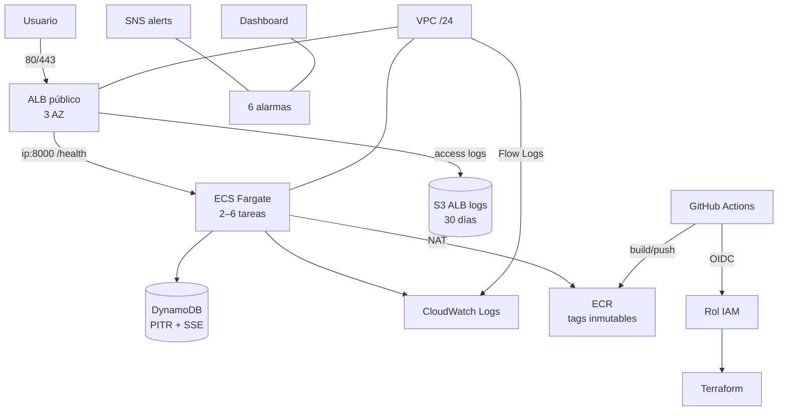

# Diseño de arquitectura — Orbidi

| | |
|---|---|
| **Estado** | Vigente |
| **Última revisión** | Fase 7 — documentación |
| **Alcance** | Infraestructura AWS, entrega de la aplicación y operación |
| **Documentos relacionados** | [`README.md`](README.md), [`PLAN.md`](PLAN.md), [`RUNBOOK.md`](RUNBOOK.md) |

---

## 1. Resumen

Orbidi despliega una API **FastAPI** contenedorizada en **ECS Fargate**, detrás de un **Application Load Balancer** público, en una **VPC multi-AZ**. La infraestructura se define con **Terraform**, el estado vive en **S3 + DynamoDB** y la entrega se automatiza con **GitHub Actions** usando **OIDC** (sin credenciales de larga duración).

El diseño prioriza:

- Alta disponibilidad en 3 zonas.
- Reproducibilidad (estado remoto, lockfile, versiones fijadas).
- Privilegio mínimo (roles separados, security groups acotados).
- Observabilidad básica desde el día uno (logs, dashboard, alarmas).
- Simplicidad operativa: Fargate evita administrar instancias y parches.

---

## 2. Contexto y objetivos

### Requisitos funcionales

- Servir una API HTTP con health check.
- Escalar horizontalmente según carga.
- Persistir datos en una base gestionada.
- Desplegar automáticamente desde GitHub.

### Requisitos no funcionales

| Atributo | Objetivo |
|---|---|
| Disponibilidad | Tolerar la caída de una AZ |
| Escalabilidad | 2–6 tareas con target tracking |
| Seguridad | Sin access keys; TLS opcional; IAM mínimo; cifrado en reposo |
| Observabilidad | Logs centralizados, métricas, alarmas y notificaciones |
| Recuperación | PITR en DynamoDB; despliegues con rollback automático |
| Costo | Predecible y optimizable (NAT es el mayor componente) |

### Fuera de alcance (por ahora)

- Multi-región / DR activo-activo.
- WAF, Shield Advanced y CDN.
- KMS con claves administradas por el cliente (CMK).
- Múltiples entornos simultáneos (`dev/staging/prod`).
- Malla de servicios o Kubernetes.

---

## 3. Estado actual

### Componentes

| Componente | Implementación |
|---|---|
| Red | VPC `10.20.30.0/24`; 3 subredes públicas y 3 privadas en 3 AZ; IGW; **3 NAT Gateway** (uno por subred pública); route tables por subred privada |
| Balanceo | ALB público en las 3 subredes públicas; target group `ip:8000`; health check `/health`; access logs a S3 |
| Cómputo | ECS Fargate; `task_cpu=256`, `task_memory=512`; 2–6 tareas; deployment circuit breaker con rollback |
| Aplicación | FastAPI con `/` y `/health`; security headers; usuario no-root; `HEALTHCHECK` |
| Datos | DynamoDB `orbidi-app`; PAY_PER_REQUEST; PITR; SSE; deletion protection opcional |
| Secretos | Inyección desde Secrets Manager/SSM vía `app_secrets` (no se crean secretos en Terraform) |
| Observabilidad | Log groups `/ecs/app-3` y flow logs; dashboard; 6 alarmas; SNS con email opcional |
| Estado | S3 versionado, cifrado y con public access block; DynamoDB lock table con PITR |
| CI/CD | Validación sin credenciales; Checkov; TFLint/Trivy; plan/apply con OIDC; imagen con tag por commit |

### Estado vs objetivos

| Objetivo | Estado | Nota |
|---|---|---|
| Multi-AZ | ✅ | 3 AZ en subredes y ALB |
| Escalado horizontal | ✅ | Target tracking de CPU |
| Sin credenciales estáticas | ✅ | OIDC GitHub→AWS |
| Cifrado en reposo | 🟡 | SSE con claves gestionadas por AWS; CMK pendiente |
| HTTPS | 🟡 | Disponible al definir `certificate_arn`; en dev queda HTTP |
| Observabilidad | ✅ | Logs, dashboard y alarmas |
| Tests automatizados | ✅ | `terraform test` con mocks + smoke test post-deploy |
| Múltiples entornos | ❌ | Fase 6 |

---

## 4. Decisiones de arquitectura (ADR)

### ADR-001 — Terraform con estado remoto y bootstrap separado

**Contexto:** el estado local impide trabajo en equipo y se pierde con el runner de CI.

**Decisión:** dos root modules:

- `bootstrap/` con estado local: bucket S3, tabla DynamoDB de locks, ECR y rol OIDC.
- `terraform/` con backend S3 + lock DynamoDB.

**Consecuencias:**

- ✅ Estado reproducible y bloqueo entre operadores.
- ✅ Se evita el problema huevo-gallina del bucket que guarda su propio estado.
- ⚠️ El bootstrap se aplica una sola vez y debe protegerse (no se destruye por accidente).
- ⚠️ Los nombres por defecto (`orbidi-tfstate-<account>`, `orbidi-terraform-locks`) deben coincidir con `backend.hcl` y CI.

**Alternativas descartadas:** Terraform Cloud (costo/duplicación), estado local (no colaborativo), backend creado por el mismo módulo (huevo-gallina).

---

### ADR-002 — ECS Fargate en lugar de EC2 + Auto Scaling

**Contexto:** el diseño original usaba ASG/EC2, pero no había `user_data`, AMI actualizada ni entrega de la aplicación. Amazon Linux 2 está EOL.

**Decisión:** ECS Fargate con task definition, servicio y target tracking.

**Consecuencias:**

- ✅ Sin parcheo de AMI ni capacidad ociosa.
- ✅ Rollback automático con circuit breaker.
- ✅ Escalado por CPU sin gestionar instancias.
- ⚠️ Mayor costo por vCPU/hora que EC2 Spot.
- ⚠️ Requiere imagen en ECR antes de arrancar tareas.

**Alternativas descartadas:** ASG + `user_data` con Docker (más mantenimiento), EKS (sobrecarga operativa para una sola API).

---

### ADR-003 — ECR administrado en `bootstrap/`

**Contexto:** CI necesita el repositorio antes de construir la imagen y ECS necesita la imagen antes de arrancar.

**Decisión:** crear ECR en `bootstrap/` y consumirlo en `terraform/` con `data "aws_ecr_repository"`.

**Consecuencias:**

- ✅ Rompe el ciclo de dependencias.
- ✅ El repositorio sobrevive a `terraform destroy` del entorno.
- ⚠️ `terraform plan` requiere que el bootstrap esté aplicado.
- ⚠️ El nombre debe coincidir en `bootstrap/`, `terraform/` y CI.

---

### ADR-004 — OIDC de GitHub en lugar de access keys

**Contexto:** las credenciales estáticas en secrets son difíciles de rotar y de alcance amplio.

**Decisión:** provider OIDC + rol `orbidi-github-actions` con trust limitado a `main` y `pull_request`.

**Consecuencias:**

- ✅ Sin secretos de AWS en GitHub.
- ✅ Credenciales temporales por ejecución.
- ⚠️ El rol usa `PowerUserAccess` + permisos IAM acotados por nombre; se puede reducir más adelante.
- ⚠️ Requiere configurar `AWS_ROLE_ARN` y `AWS_DEPLOY_ENABLED`.

---

### ADR-005 — HTTPS opcional con certificado externo

**Contexto:** no hay dominio ni zona Route53 definidos en el repositorio.

**Decisión:** `certificate_arn` opcional. Si se define, se crea listener 443 con TLS 1.3/1.2 y el listener 80 redirige. La app envía HSTS.

**Consecuencias:**

- ✅ No bloquea dev con HTTP.
- ✅ Producción puede habilitar TLS sin cambios de código.
- ⚠️ La emisión/validación del certificado ACM queda fuera de Terraform.
- ⚠️ Sin certificado, Checkov omite las reglas de HTTPS (baseline documentado).

---

### ADR-006 — Observabilidad con CloudWatch + SNS

**Contexto:** se necesita detección temprana sin introducir un stack de terceros.

**Decisión:** log groups, dashboard, 6 alarmas y SNS.

**Consecuencias:**

- ✅ Sin dependencias externas ni costo fijo adicional.
- ✅ Alarmas accionables y runbook.
- ⚠️ Sin trazas distribuidas ni métricas de negocio.
- ⚠️ Retención de logs limitada por costo.

---

### ADR-007 — DynamoDB como base de datos

**Contexto:** los datos son clave-valor y el volumen inicial es bajo.

**Decisión:** DynamoDB on-demand con PITR y SSE.

**Consecuencias:**

- ✅ Sin servidores ni mantenimiento.
- ✅ Escalado automático y bajo costo inicial.
- ⚠️ Requiere modelar accesos por clave; consultas ad-hoc limitadas.
- ⚠️ CMK pendiente (Fase 6).

---

### ADR-008 — Archivos planos antes que módulos

**Contexto:** el repositorio es pequeño y los módulos prematuros agregan indirección.

**Decisión:** mantener `terraform/*.tf` planos y extraer módulos en la Fase 6.

**Consecuencias:**

- ✅ Curva de lectura baja.
- ✅ Cambios localizados.
- ⚠️ Duplicación si aparecen múltiples entornos.

---

## 5. Modelo de seguridad

| Control | Implementación |
|---|---|
| Identidad de CI | OIDC + rol con trust por repositorio/ref |
| IAM de aplicación | Rol de ejecución (ECR/Logs/Secretos) y rol de tarea (DynamoDB mínimo) |
| Red | Subredes privadas para tareas; ALB en públicas; SG ALB→ECS solo en `container_port` |
| Egress | 443 y DNS 53 |
| Cifrado en tránsito | TLS opcional en ALB; HTTP interno en la VPC |
| Cifrado en reposo | S3 SSE, DynamoDB SSE, CloudWatch Logs (clave gestionada) |
| Auditoría | VPC Flow Logs + ALB access logs + logs de aplicación |
| Calidad | Checkov bloqueante con baseline; TFLint/Trivy bloqueantes con supresiones justificadas |

### Riesgos aceptados

| Riesgo | Mitigación actual | Plan |
|---|---|---|
| Sin WAF | ALB + SG + IAM | Fase 6 |
| Sin CMK | Claves gestionadas por AWS | Fase 6 |
| Egress a 443 abierto | Sin VPC Endpoints aún | Fase 6 |
| HTTP en dev | `certificate_arn` en prod | Definir certificado |
| Un solo entorno | `environment` como variable | Fase 6 |

---

## 6. Costos

| Recurso | Driver | Optimización |
|---|---|---|
| NAT Gateway (3) | Horas + GB procesados | VPC Endpoints; 1–2 NAT por entorno |
| ALB | Horas + LCU | Compartido entre servicios |
| Fargate | vCPU/GB-hora | Graviton, right-sizing, Savings Plans |
| DynamoDB | RCU/WCU on-demand | Revisar patrones de acceso |
| CloudWatch | Ingesta y retención | Retención 30 días; filtros |

Orden de magnitud: **~USD 140–150/mes** en us-east-1, dominado por NAT.

---

## 7. Evolución

| Fase | Foco |
|---|---|
| 5 ✅ | Tests de plan con `mock_provider`, smoke test post-deploy, gates bloqueantes |
| 6 | WAF, CMK, VPC Endpoints, módulos, entornos, DR |
| 7 ✅ | Esta documentación; se mantiene junto a cada cambio |

Detalle y estado por hallazgo: [`PLAN.md`](PLAN.md).
